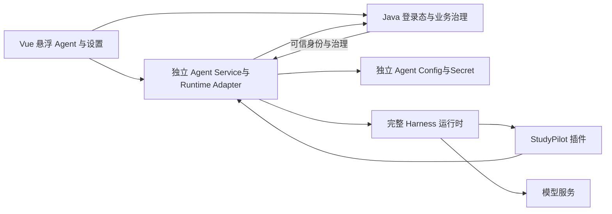

# StudyPilot Harness 接入设计

日期：2026-10-08。状态：兼容性评估完成，按后续需求更新架构，实施待启动。

用户已明确，本轮只完成评估与接入设计。“原能力不变”指业务接入不能破坏原 harness 推理机制，不要求保持全部主机操作权限或保证所有问题得分完全相同。

## 后续需求与最终架构（本节覆盖旧接入范围）

依据用户引用的“嵌入 Harness Runtime”对话及本轮规划请求，新增以下明确要求。引用助手的推断仍须验证；其中的示例工具名称不改变现有冻结名称。

- Runtime 是可替换子系统。独立 Agent Service 拥有 Runtime Adapter、会话、模型 Config 与 Secret，原 StudyPilot Java 保持身份/业务治理边界；旧 AI Service 不再作为新 Agent 编排的唯一宿主。
- 前端使用全局悬浮球，左键打开、右键菜单提供新会话/历史/设置/状态。窗口继承实际 Harness 的对话、工具树、Working/Stop和历史交互，以 Vue组件实现，不 iframe 整个应用。
- Provider/base URL/model/API Key/runtime 参数进入独立 Agent Config，不进入 Java业务配置或模型凭据存储。设置请求通过 `/agent-api/**` 进入 Agent Service，Java只签发身份凭据，不处理模型 Secret 请求体；主业务继续 `/api/**`。
- API Key 仅在设置提交期间短暂存在表单内存，提交后清空；不进入持久浏览器存储、全局 Vue store、日志或会话。Agent Service按 owner 加密存储，读取只给脱敏信息。
- Capability Manifest由真实 Java工具描述符和用途元数据编译，覆盖完整项目能力与暴露状态；包含 schema、用途/不用场景、副作用、权限、确认、幂等、错误、例子和成本提示。静态目录缓存，会话工具按权限/状态/意图筛选，不能声称模型每次请求不再发送工具定义。
- 页面只提供结构化定位信息，真实数据仍经工具读取；事实指标直接使用已有业务结果，不由模型重算后冒充权威值。页面切换不限制用户跨页目标。
- Java 原凭据 API及所有旧 AI 消费者纳入迁移，不能只新增设置页就宣称解耦。旧 Agent交互/健康/模型设置入口在替代能力通过后退役；业务学习页面、审计及历史数据保留，旧路由同步契约并兼容跳转。
- 优先 DeepSeek+Harness，使用固定16场景同模型/工具/预算成对测量。原生适配优势是待验证假设。

实施分为12个 Task，详见[正式实施计划](../plans/2026-10-08-studypilot-pluggable-harness-runtime.md)。本轮只更新设计和计划，不执行上述迁移。

## 结论与证据边界

可行。使用完整 `sdk` 组合及独立 StudyPilot 插件，保留原模型流、工具反馈循环、压缩、子 Agent 和恢复机制。替换平台内的固定规划入口，不把 harness 接在旧 Planner 后再要求输出旧版 `AssistantPlan`。

本轮完成源码检查和一个真实 Schema 校验实验。未启动新运行时、调用付费模型、修改生产代码、业务数据或配置，未提交、推送、合并。内嵌浏览器此前无项目标签页；新打开 `http://localhost:5173` 后进入登录页，未能读取用户最新对话。因此以下为结构诊断，不能宣称已复现该具体对话缺陷。

核查基线如下。提交号不是干净工作区证明，必须包含当前本地修复再实施。

| 组件 | 实际源码 | HEAD |
| --- | --- | --- |
| Harness | `/Users/moxiao/Desktop/Deepseek Harness` | `ddefc45fbc7f8e46dd73185e68295696d1297887` |
| AI / Web | `/Users/moxiao/IdeaProjects/project-zcode-task-33` | `0fe122d2169ed4a9ec6e3a1e65ce514883b0fb40` |
| Java | `/Users/moxiao/IdeaProjects/project-minimax-task-33` | `2c5194a918265644f3068a46c904d909dae3cad7` |

根目录 `start-project.sh:26` 选择以上组件，不应基于根目录旧业务源码或 harness 的 `workspaces/studypilot-task31` 副本实施。

## 当前机械行为的结构来源

- 实际 AI 的 `app/unified_agent/planner.py:143` 只构造 system 与当前消息/上下文输入，不包含平台保存的历史对话。Supervisor 在 1181 行调用 propose 也不传历史，追问的指代难以由该规划路径解析。
- Planner 提前生成最多 8 步、最多 1 次搜索的固定计划。Supervisor 的 `_run_plan` 在 1879 行按既定步骤执行，工具结果没有触发同一规划模型继续判断。
- `_compose_completed_plan_reply` 在 1995 行开始用模板整理事实；模型规划不可用时回落关键词分支。不是所有聊天路径都使用模板，不把此结论推广为模型本身能力不足。
- 旧 ToolGateway 的整轮签名集合禁止重复参数调用，包括之前失败或业务状态改变后的读取。新路径采用正在进行的调用去重、有限失败重试、写幂等、结果缓存失效和总预算，不照搬永久整轮封禁。

## 运行边界

Harness 负责决定下一步、消费结果、继续推理和生成回答。Java 保持业务事实与授权真值来源；独立 Agent Service 负责用户绑定、调用桥、会话映射、事件投影和独立配置域。

首版每个活跃业务会话独占运行时与隔离 home/workspace，空闲实例有界回收。避免现成 SDK 进程级模型配置、凭据和全进程事件广播产生跨用户污染。后续若引入共享实例池，需先证明独立 scope、凭据路由和事件隔离。子 Agent 继承可信业务 scope、用量归属和允许的工具，不能自己增加权限。

Java `/api/**` 保持业务操作；Agent `/agent-api/**` 由独立服务处理，新会话接口遵守已发布的 Runtime契约。前端不直连模型、stdio或内部工具。同步 run 不放在 FastAPI事件循环；使用后台worker/非阻塞传输，发送接口入队后返回。确认通知必须在运行完成前显示。

## 兼容矩阵

| 能力或契约 | 判断 | 接入方式 |
| --- | --- | --- |
| 原模型→工具→模型循环 | 可直接保留 | `agent-loop/src/agent.ts:270` 的 turn/step 和 487 行工具执行不改 |
| 原压缩、重试、子 Agent、PTC | 完整配置可保留 | 基于 base + sdk-app；不用 sdk-minimal 代替 |
| 领域身份与动态上下文 | 插件可扩展 | system-prompt sections/context；替换 SDK 默认 coding persona，保留通用推理提示 |
| Java 工具目录 | 需适配 | 原名称/版本不变，映射到 `tools.register`；Schema 正规化；实际请求仍由后端校验 |
| 业务身份、凭据 | 需新增绑定 | owner 从 Java 登录态获得；插件不接受模型给出的 owner、URL、令牌 |
| 模型预算及统计 | 不直接兼容 | 新插件在 `llm/stream` 调用边界预占、上报 usage、处理错误释放；覆盖压缩和子 Agent 调用 |
| 流式输出与 SSE | 需投影 | 按会话、turn、message、call 标识将原持久事件映射到平台事件；先持久化再发布 |
| 业务确认和交互提问 | 需控制桥 | 绑定原 approval/question answerer；Java 业务确认独立作为实际写入门禁 |
| 单会话停止、插话 | SDK 缺口 | 薄控制桥调用原 cancel/steer；不以 shutdown 代替停止 |
| 同进程多轮对话 | 可保留 | 稳定 session 映射，原 followup 将输入追加到日志 |
| 运行时重启恢复 | SDK 缺口 | 显式调用原 agents.resume；只重传旧 ID 会发生已存在错误 |
| 旧会话迁移 | 需转换规则 | 仅导入已完成的可信历史；未完成写入先核对，不复制旧 suspended plan |

### 工具桥与 Schema

Java `InternalAgentToolController` 已提供 `/internal/agent-tools/catalog` 和 `/{toolName}/invoke`。插件调用受鉴权的适配桥，适配桥复用 JavaBackendClient 与服务端校验；不接收模型任意目标地址。

Harness 需要规范 JSON 值与 output schema/render，不能只返回卡片文案。业务响应保留 `data`、`truncated`、action ID/版本与状态。空路线是有效 null；截断不是完整证据；HTTP 失败不伪装为无数据。工具错误通过原工具结果反馈供模型判断补查，连续错误或预算耗尽给出可见原因。

Java `AgentToolOutputSchemas.java:489` 输出 `type: [T, "null"]`；Harness `tools/src/json-schema.ts:305` 不支持类型数组。适配器递归转换为互斥 `oneOf` 分支，保留 required、对象/数组约束和所有原字段。不能删除不支持的关键字后假装等价；遇到不能无损表达的 schema，拒绝加载该工具并报告具体字段。

实测命令在桌面 harness 目录使用已有 Node/tsx，直接调用原 `assertSupportedJsonSchema`。结果：nullable 类型数组被拒绝；等价 object/null `oneOf` 被接受，进程 exit 0。该实验验证具体差异，尚未验证全部工具目录、模型侧名称限制或 PTC 投影。实施前须以真实目录做全量覆盖，点号工具名用原 wire 名称和合法属性访问，不擅自改冻结业务名称。

### 待新增控制桥（不是已有 SDK 方法）

现有 SDK 仅有 initialize、session/prompt、shutdown。下面是独立 StudyPilot 传输插件设计，不修改原推理 loop。插件统一拥有 session→AgentHandle 注册表，create、resume、prompt、cancel 和退出清理都使用同一注册表。profile 使用该插件替代原 SDK server 入口，并复用其协议形状及事件投影思路；原 SDK 保持可独立运行。

不能由外围插件先 create/resume，再原样调用原 SDK server 的 session/prompt。原 server 的私有 sessions map 不认识外围 handle，会再次 create 同 ID 并冲突。Python 侧为新传输插件增加独立客户端，不直接使用高层 DeepSeekHarness.run 完成全部交互。

| 操作 | 行为 |
| --- | --- |
| open(create/resume) | 校验业务会话归属，建立不可由模型更改的 session/owner/turn 映射，调用原 create/resume |
| prompt | 在统一注册表中取得 handle，构造原 user message 并调用 agent.followup，保持 session/prompt 的 messageId 入队回执形状 |
| cancel | 针对该 agent 传播原取消信号，同时取消待答 promise 和未发出的业务请求 |
| pending 通知 | 发送可审核内容、requestId、会话与调用关联，持久化展示状态 |
| respond | 校验 owner、requestId、允许值、有效期及终态；迟到或重复答复不重新执行 |
| steer（后续） | 在原步骤边界插入新指示，保持原 steer 机制 |

运行时关闭由同一 owner dispose 所有 handle、待答交互及订阅；不能只调用原 SDK shutdown，因为它不拥有这些插件创建的 Agent。

普通缺少信息可由模型自然提问，下一条用户消息直接继续原会话；只有工具需要结构化答案时使用 question 控制桥。缺少 answerer 时原 approval 为 unavailable，question 抛 NO_PROVIDER，不等于已支持交互。answerer 必须监听取消信号并清理 pending。

### 写入与恢复

Java 确认是业务授权真值。Harness 的通用工具许可不能代替业务确认，也不能产生重复确认卡。写工具创建现有 preview/action 后，插件保持当前调用待完成，平台展示原确认卡。用户通过现有 confirm/reject API 操作，适配桥校验 Java 实际状态再 settle；执行结果才返回模型继续推理。

同一幂等键只属于同一预览/写操作；普通聊天不确认写入。工具返回 PENDING 不能投影成 TOOL_SUCCEEDED；导航收到前端终态回执后才宣称页面已打开。

崩溃后原 resume 修复会话日志，但不会恢复旧 promise，也不保证外部写入 exactly-once。持久化 operation→Java action/execution/idempotency 关联，先查询真实结果，再给模型注入已执行/拒绝/过期/仍待确认事实。未确定的写入不重发；禁止用删除日志、换 session ID 或重新执行全部历史“恢复”。

### 事件与预算

只将该根会话的最终输出展示为用户回复；子 Agent 文本用于内部结果，子任务可显示进度。原工具/模型事件映射到既有 AssistantEvent，reasoning 块不自动混为最终回答。增量按标识去重，保持 lastEventSequence 与快照文本一致。

`max-tokens` 等中止原因不能因为 SDK 默认把它映射为 ok 就标成业务完成。保留结束原因，取消、失败、等待确认分别投影到平台状态。

`model_factory.py` 的 BudgetedChatModel 不包裹 Harness provider。新增模型边界插件使用既有 Java 预算服务；预算耗尽清晰反馈，不能无声切回关键词回复。监听 hook 不能改写 loop 组装的不可变请求内容。模型密钥不进入提示、会话日志或工具参数；模型路由和 reasoning 配置不因业务身份提示改变。

## 实施范围与验收门禁

1. H01～H06 完成基线、Manifest、完整Runtime、独立Config、治理和只读工具；治理完成后才能做真实模型成对评测。
2. H07～H09 完成全局悬浮球、Harness风格Workspace/设置和页面上下文/自主判断；逐项真实页面试用。
3. H10～H12 完成交互/恢复、受治理写入、全量评测、旧入口及配置消费者迁移和停用/替换/回退验证。

每个切片先有失败测试再实现，按实际变化复跑检查。上线前保留旧运行时配置开关，但同一会话固定 engine/version，不能在错误时静默混用历史或切引擎。灰度切换只用于新会话，旧会话保留查看与显式迁移。范围不包含训练模型、项目源码/Git 自动操作或扩大本机权限。

| 场景 | 必须看到的证据 |
| --- | --- |
| 工具结果改变下一步 | 模型看到真实结果后追加此前未定的查询；不是预生成固定计划 |
| 含糊指令与追问 | 结合历史理解“刚才那个/改成两天”；缺少事实时具体澄清，不重复固定文案 |
| 查询后判断 | 基于任务/掌握度证据解释建议；允许自然回答而非只输出结构化计划 |
| 空状态、截断、失败 | null 正常；截断可补查；工具失败可有限恢复，真实异常有原因 |
| 多轮及重启 | 原日志历史恢复，已展示消息和已执行动作不重复 |
| 用户与子 Agent | 不能交叉读写、串用凭据或漏预算；子 Agent 不能绕过授权 |
| 取消与确认 | 单会话取消不影响他人；停后无新增调用；迟到答复无副作用 |
| 模型预算 | 每次真实请求包含压缩、重试和子任务均预占并正确统计 |
| 原机制保持 | 原 loop/调度/压缩/恢复源码无业务补丁；插件只提供上下文、工具和边界策略 |

本轮判定为“架构可行，存在明确且可隔离的适配缺口”。真实业务效果、所有插件组装、SDK 扩展及用户体验尚未验证，不标成接入完成。
