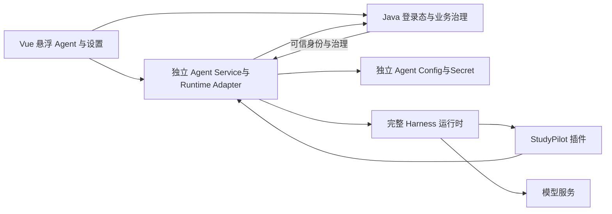

# StudyPilot：DeepSeek Harness 嵌入开发规划交接

日期：2026-10-10。用途：交给更高级模型独立评审、重新规划；本文不是新增实施授权。主文描述需求与当前证据，附录保存既有方案供批判性审查。附录中的旧状态、勾选框和建议不能替代主文的当前状态。

## 1. 用户要实现的结果

把本机 DeepSeek Harness 的完整 Agent 运行能力嵌入 StudyPilot，使它成为专精学习业务、可替换且可拔除的 Runtime。希望模型能理解用户意图、选择业务工具、依据工具结果继续判断、补查或追问，而不是执行固定短计划后拼接模板答案。

“原能力不变”指保留原推理循环、流式模型调用、工具调度、多轮历史、上下文压缩、恢复及适用的交互机制。它不意味着对 StudyPilot 用户开放原 coding、文件系统、shell 或所有插件，也不意味着未经测量就承诺回答质量与原生完全相同。推理机制保留和业务权限限制必须分别设计。

所有业务页都能使用全局悬浮 Agent。建议左键打开对话，右键提供新会话、历史、设置与状态；窗口呈现消息、工具过程、Working/Stop、追问和待确认动作。使用 Vue 原生组件，不把整个桌面应用 iframe 嵌进网站。模型及 API Key 设置归独立 Agent 子系统，最终替换旧独立 Agent/模型设置入口；学习计划、任务、路线、资料和业务历史保留。

## 2. 当前交付状态与授权边界

H01 已获用户验收，冻结 Runtime 契约与离线基线。H02 Capability Manifest 尚未整体通过。H03 及后续实施未授权；定时任务按用户要求暂停。本文整理需求，不启动服务、不调用付费模型、不合并分支。

截至本次磁盘核对，H02 三端提交：

| Owner | 当前提交 | 独立验证及限制 |
| --- | --- | --- |
| MiniMax Code | 6f131ec6ca1859031478ad659e5e1fb5d325d1eb | 上轮 49 项测试及 R-M11 定向检查已通过；最终最新输入的三端交叉验收待完成 |
| DeepSeek Harness | 82ec83b0f94a09448b68b5b45c67db59ad7bc9d0 | 上轮 69 项测试、8 项来源检查及显式 --check 通过；类型化 fixtures 是合成实例，不是真实业务或模型质量证据 |
| ZCode | b23dd9d72e2d23d4da8a2edbfcfb3653a77a89ae | 最新独立 42 项测试、旧 6 项控制通过；同一 Controller 的错误真实端点、虚构 keyFields 仍被接受，需原 Owner 整改 |

当前阻塞：权威事实来源尚未严格核验具体 HTTP 操作的服务委托及响应 DTO 字段。不能用 Controller 中存在某个方法、关键词命中、自述完成或测试数量代替来源证据。ZCode 下一轮整改草稿未送达；不得把上一轮 sent 状态当本轮已发送。技术备份到 GitHub 也不等于验收通过。

H02 共用基线：16b37d34c882a17e7bc45c69c84411f28f52bff8。H01 Runtime 契约指纹冻结，未经明确变更流程不修改。各工作树 backend/mvnw.cmd 的 CRLF 差异属于已知快照工件。

## 3. 既有候选架构及必须审查的接口

既有方案新增独立 agent-service，负责 RuntimeAdapter、配置、Secret、会话、交互、事件；Java 负责身份、业务事实、权限、业务确认、预算与审计；现有 ai-service 保留检索等功能并迁移模型配置消费；Vue 经同源 /agent-api 访问新服务，业务 /api 继续访问 Java。请评审这一拆分是否必要、成本是否合理，并给出取舍，不能仅复述旧方案。

Runtime 层使用完整 base + sdk-app 组合及业务插件。旧 SDK 的 initialize/prompt/shutdown 不足以覆盖 create/resume/cancel/steer/respond/pending；sdk-minimal 缺少所需机制，不能直接替换完整组合后宣称保留能力。领域 persona/profile 取代 coding 默认提示，核心 loop 保持可溯源。单一 AgentHandle 注册表负责所有会话生命周期，不能混用外围 create 与原 SDK 私有 sessions map。

首次实现倾向按活跃业务会话隔离 runtime home/workspace，设实例上限、空闲回收；共享进程方案必须证明用户隔离。同步 SDK 调用不得阻塞 FastAPI 事件循环；运行与传输之间需要受控 worker 和异步事件队列。子 Agent 必须继承可信 owner/scope/budget，不能扩大权限。

## 4. 业务工具、事实与 Schema

Capability Manifest 从真实 Java 注册描述符加语义元数据编译，不能人工字典自证绑定。完整集合须双向相等，拒绝遗漏、重复、虚构 handler、错误接收者与方法配对。Manifest 包括名称、版本、用途与禁用场景、输入输出 Schema、副作用、权限、确认、幂等、错误、示例、成本提示、暴露状态及来源 commit/hash。

覆盖所有已登记工具、真实前端 router 与公开 Controller 业务操作。学习进度、掌握度等权威事实必须追溯到具体端点、服务调用、响应 DTO 与字段；页面上下文仅用于定位，不是真值或权限。模型不得提供 owner 或任意业务 URL。

完整 Schema 与实例验证应执行支持的约束，遇到不支持的约束失败关闭，不能静默删除或跳过占位输出。Java nullable 类型数组与 Harness oneOf 之间需要递归、语义等价投影和正反例证据；单个实验通过不能证明 H06 全部工具可用。输出必须保留结构化 data、状态、错误、truncated、actionVersion 等；null 不等于缺字段，截断不是完整结果，工具错误不能转换为空成功。

写入、LOCAL、coding 能力在目录中可追踪，但按治理禁用；写工具待 H11 才能开放。模型筛选能力不能替代 Java 后端鉴权。

## 5. Secret、预算、恢复与事件的硬要求

- Agent 设置按 owner 隔离，秘密与普通配置分离。服务端加密保存，主密钥来自运行环境，不进入 Git 或业务库；读取只返回脱敏状态。浏览器输入表单短暂持有 Key，提交后清空，不能进入 store、localStorage、sessionStorage、事件或日志。
- Java 签发短时、可撤销、限定 owner/audience/scope 的接入身份；身份凭据与模型 Key 是两个独立概念。不能通过 Java 模型配置接口继续暗中获取 Key。
- 预算控制覆盖原 llm/stream 边界，包括压缩、重试、子 Agent。原有 Python BudgetedChatModel 不会自动包住 Harness；重试和子 Agent 用量不能漏计。配置变更默认新会话生效，禁止 mid-turn 偷换模型或静默降级到旧固定 Planner。
- SSE 事件先持久化再发布，带序号、turn/message/call 标识与去重规则；子 Agent 消息不冒充 root 最终回复。max_tokens、failed、cancelled 与 completed 分开。
- 原 resume 保留历史，但不自动恢复旧 Promise 或保证外部业务恰好一次。持久化 operation/action 映射并查询 Java 实际状态；未知写入结果不得重发。不能用历史重放或新 session ID 冒充恢复。
- 写操作沿用 Java preview/action/confirm/reject，通用 Harness approval 不替代业务确认。pending 不算执行成功；导航需要前端最终回执。

## 6. 待重新审查的分期方案

| Task | 候选交付 | 主要门禁 |
| --- | --- | --- |
| H01 | 基线、Runtime 契约、16 固定场景 | 已验收，冻结边界 |
| H02 | 能力清单、完整业务覆盖和真值来源 | 当前未过，先关闭来源缺陷并三端交叉消费 |
| H03 | 完整 Runtime 与统一控制桥 | mock 下真实多轮调用、取消、resume、回收 |
| H04 | 独立配置及 Secret | owner 隔离、脱敏、配置版本 |
| H05 | 身份、Session Capability、预算 | 越权与预算硬失败；覆盖原模型调用路径 |
| H06 | 只读业务工具桥 | 全量 Schema 投影与真实结果语义 |
| H07 | 全局悬浮壳 | 首次网页可体验里程碑 |
| H08 | 对话 Workspace、历史、设置 | 完整 UI 状态与真实支持配置 |
| H09 | 页面上下文、自主判断 | 工具后二次判断、补查、追问主要体验门禁 |
| H10 | 结构化提问、插话、停止、持久恢复 | 未决交互与重启恢复正确 |
| H11 | 写入、业务确认、幂等 | Java 实际状态与未知结果安全恢复 |
| H12 | 成对评测、旧入口迁移、可拔除回退 | 无关键硬失败并经用户体验验收 |

上述编号为既有候选，不要求规划模型机械保留。每 Task 需执行端交付、Codex 独立技术验收及用户体验验收，再获得下一 Task 授权。Codex 主责设计、派发、协调、审查；Owner 的生产文件由原执行端开发，不由 Codex 代写。

## 7. 请规划模型给出的具体成果

1. 明确区分必须保持的原机制、可替换的外壳、禁止开放的宿主能力；指出旧方案中矛盾、过度设计与尚无证据的假设。
2. 比较独立服务与复用现有服务、独立会话实例与共享进程、直接 SDK 与控制插件三个关键取舍，推荐一种并解释代价。
3. 给出最小纵向可运行切片、逐阶段依赖、文件职责、协议数据流、测试与用户可试用节点；避免基础设施长期做完却无法体验。
4. 明确 model/Secret/identity/budget 的唯一事实来源、迁移顺序、兼容期与回退，不让两套入口长期并存。
5. 设计原生与接入版同模型、工具、fixtures、预算的 16 场景成对测量，分别报告事实正确性、治理硬失败、答案质量、token/成本与耗时；不要以品牌相同宣称效果相同。真实评测要单独授权。
6. 给出可执行的缺陷闭环与验收矩阵，特别覆盖跨用户泄漏、Schema 不支持、截断/空值、取消、压缩、子 Agent 用量、断线恢复和未知写入结果。
7. 标出必须查阅原源码后才能决定的细节，不编造 SDK 接口；输出供用户审阅的修改后开发文档，不自动执行开发或扩大授权。

## 8. 可直接交给规划模型的提示词

> 请以资深架构与 Agent Runtime 工程师身份，独立审查本文及附录，重新规划 StudyPilot 嵌入完整 DeepSeek Harness。重点保留原推理与恢复机制，同时落实学习业务、用户隔离、独立模型配置、全局悬浮交互和可替换边界。请挑战既有方案，明确事实/推断/待查证，输出架构取舍、最小纵向切片、阶段任务与依赖、Owner 文件边界、验证矩阵、迁移回退与需要用户决策的问题。H01 已验收，H02 未通过，H03 未授权；本次仅规划。不要声称 mock 或合成实例已证明真实模型质量，不把附录建议视为强制方案，不执行代码、付费评测或部署。

## 9. 本地证据入口

仓库：/Users/moxiao/IdeaProjects/project（实际 Git 根 StudyPilot）。原 Harness 源码参考：/Users/moxiao/Desktop/Deepseek Harness；既有评估记录的源码 commit 为 ddefc45fbc7f8e46dd73185e68295696d1297887，本文未重新验证其当前 HEAD。

当前状态：docs/verification/harness/h02-dispatch-state.json。最新 ZCode 缺陷证据：h02-codex-zcode-round7.md、h02-codex-zcode-round7-extra-controls.json/mjs。H01 原机制审计：DeepSeek 工作树 docs/verification/harness/h01-deepseek.md。完整原设计与任务计划已附于下方，离开本机也能阅读；评测日志和源码仍须另行提供，本文不替代它们。

---

# 附录 A：既有接入设计全文（历史方案，供审查）

# StudyPilot Harness 接入设计

日期：2026-10-08。状态：兼容性评估完成，按后续需求更新架构，实施待启动。

用户已明确，本轮只完成评估与接入设计。“原能力不变”指业务接入不能破坏原 harness 推理机制，不要求保持全部主机操作权限或保证所有问题得分完全相同。

## 后续需求与最终架构（本节覆盖旧接入范围）

依据用户引用的“嵌入 Harness Runtime”对话及本轮规划请求，新增以下明确要求。引用助手的推断仍须验证；其中的示例工具名称不改变现有冻结名称。

- Runtime 是可替换子系统。独立 Agent Service 拥有 Runtime Adapter、会话、模型 Config 与 Secret，原 StudyPilot Java 保持身份/业务治理边界；旧 AI Service 不再作为新 Agent 编排的唯一宿主。
- 前端使用全局悬浮球，左键打开、右键菜单提供新会话/历史/设置/状态。窗口继承实际 Harness 的对话、工具树、Working/Stop和历史交互，以 Vue组件实现，不 iframe 整个应用。
- Provider/base URL/model/API Key/runtime 参数进入独立 Agent Config，不进入 Java业务配置或模型凭据存储。设置请求通过 `/agent-api/**` 进入 Agent Service，Java只签发身份凭据，不处理模型 Secret 请求体；主业务继续 `/api/**`。
- API Key 仅在设置提交期间短暂存在表单内存，提交后清空；不进入持久浏览器存储、全局 Vue store、日志或会话。Agent Service按 owner 加密存储，读取只给脱敏信息。
- Capability Manifest由真实 Java工具描述符和用途元数据编译，覆盖完整项目能力与暴露状态；包含 schema、用途/不用场景、副作用、权限、确认、幂等、错误、例子和成本提示。静态目录缓存，会话工具按权限/状态/意图筛选，不能声称模型每次请求不再发送工具定义。
- 页面只提供结构化定位信息，真实数据仍经工具读取；事实指标直接使用已有业务结果，不由模型重算后冒充权威值。页面切换不限制用户跨页目标。
- Java 原凭据 API及所有旧 AI 消费者纳入迁移，不能只新增设置页就宣称解耦。旧 Agent交互/健康/模型设置入口在替代能力通过后退役；业务学习页面、审计及历史数据保留，旧路由同步契约并兼容跳转。
- 优先 DeepSeek+Harness，使用固定16场景同模型/工具/预算成对测量。原生适配优势是待验证假设。

实施分为12个 Task，详见[正式实施计划](../plans/2026-10-08-studypilot-pluggable-harness-runtime.md)。本轮只更新设计和计划，不执行上述迁移。

## 结论与证据边界

可行。使用完整 `sdk` 组合及独立 StudyPilot 插件，保留原模型流、工具反馈循环、压缩、子 Agent 和恢复机制。替换平台内的固定规划入口，不把 harness 接在旧 Planner 后再要求输出旧版 `AssistantPlan`。

本轮完成源码检查和一个真实 Schema 校验实验。未启动新运行时、调用付费模型、修改生产代码、业务数据或配置，未提交、推送、合并。内嵌浏览器此前无项目标签页；新打开 `http://localhost:5173` 后进入登录页，未能读取用户最新对话。因此以下为结构诊断，不能宣称已复现该具体对话缺陷。

核查基线如下。提交号不是干净工作区证明，必须包含当前本地修复再实施。

| 组件 | 实际源码 | HEAD |
| --- | --- | --- |
| Harness | `/Users/moxiao/Desktop/Deepseek Harness` | `ddefc45fbc7f8e46dd73185e68295696d1297887` |
| AI / Web | `/Users/moxiao/IdeaProjects/project-zcode-task-33` | `0fe122d2169ed4a9ec6e3a1e65ce514883b0fb40` |
| Java | `/Users/moxiao/IdeaProjects/project-minimax-task-33` | `2c5194a918265644f3068a46c904d909dae3cad7` |

根目录 `start-project.sh:26` 选择以上组件，不应基于根目录旧业务源码或 harness 的 `workspaces/studypilot-task31` 副本实施。

## 当前机械行为的结构来源

- 实际 AI 的 `app/unified_agent/planner.py:143` 只构造 system 与当前消息/上下文输入，不包含平台保存的历史对话。Supervisor 在 1181 行调用 propose 也不传历史，追问的指代难以由该规划路径解析。
- Planner 提前生成最多 8 步、最多 1 次搜索的固定计划。Supervisor 的 `_run_plan` 在 1879 行按既定步骤执行，工具结果没有触发同一规划模型继续判断。
- `_compose_completed_plan_reply` 在 1995 行开始用模板整理事实；模型规划不可用时回落关键词分支。不是所有聊天路径都使用模板，不把此结论推广为模型本身能力不足。
- 旧 ToolGateway 的整轮签名集合禁止重复参数调用，包括之前失败或业务状态改变后的读取。新路径采用正在进行的调用去重、有限失败重试、写幂等、结果缓存失效和总预算，不照搬永久整轮封禁。

## 运行边界

Harness 负责决定下一步、消费结果、继续推理和生成回答。Java 保持业务事实与授权真值来源；独立 Agent Service 负责用户绑定、调用桥、会话映射、事件投影和独立配置域。

首版每个活跃业务会话独占运行时与隔离 home/workspace，空闲实例有界回收。避免现成 SDK 进程级模型配置、凭据和全进程事件广播产生跨用户污染。后续若引入共享实例池，需先证明独立 scope、凭据路由和事件隔离。子 Agent 继承可信业务 scope、用量归属和允许的工具，不能自己增加权限。

Java `/api/**` 保持业务操作；Agent `/agent-api/**` 由独立服务处理，新会话接口遵守已发布的 Runtime契约。前端不直连模型、stdio或内部工具。同步 run 不放在 FastAPI事件循环；使用后台worker/非阻塞传输，发送接口入队后返回。确认通知必须在运行完成前显示。

## 兼容矩阵

| 能力或契约 | 判断 | 接入方式 |
| --- | --- | --- |
| 原模型→工具→模型循环 | 可直接保留 | `agent-loop/src/agent.ts:270` 的 turn/step 和 487 行工具执行不改 |
| 原压缩、重试、子 Agent、PTC | 完整配置可保留 | 基于 base + sdk-app；不用 sdk-minimal 代替 |
| 领域身份与动态上下文 | 插件可扩展 | system-prompt sections/context；替换 SDK 默认 coding persona，保留通用推理提示 |
| Java 工具目录 | 需适配 | 原名称/版本不变，映射到 `tools.register`；Schema 正规化；实际请求仍由后端校验 |
| 业务身份、凭据 | 需新增绑定 | owner 从 Java 登录态获得；插件不接受模型给出的 owner、URL、令牌 |
| 模型预算及统计 | 不直接兼容 | 新插件在 `llm/stream` 调用边界预占、上报 usage、处理错误释放；覆盖压缩和子 Agent 调用 |
| 流式输出与 SSE | 需投影 | 按会话、turn、message、call 标识将原持久事件映射到平台事件；先持久化再发布 |
| 业务确认和交互提问 | 需控制桥 | 绑定原 approval/question answerer；Java 业务确认独立作为实际写入门禁 |
| 单会话停止、插话 | SDK 缺口 | 薄控制桥调用原 cancel/steer；不以 shutdown 代替停止 |
| 同进程多轮对话 | 可保留 | 稳定 session 映射，原 followup 将输入追加到日志 |
| 运行时重启恢复 | SDK 缺口 | 显式调用原 agents.resume；只重传旧 ID 会发生已存在错误 |
| 旧会话迁移 | 需转换规则 | 仅导入已完成的可信历史；未完成写入先核对，不复制旧 suspended plan |

### 工具桥与 Schema

Java `InternalAgentToolController` 已提供 `/internal/agent-tools/catalog` 和 `/{toolName}/invoke`。插件调用受鉴权的适配桥，适配桥复用 JavaBackendClient 与服务端校验；不接收模型任意目标地址。

Harness 需要规范 JSON 值与 output schema/render，不能只返回卡片文案。业务响应保留 `data`、`truncated`、action ID/版本与状态。空路线是有效 null；截断不是完整证据；HTTP 失败不伪装为无数据。工具错误通过原工具结果反馈供模型判断补查，连续错误或预算耗尽给出可见原因。

Java `AgentToolOutputSchemas.java:489` 输出 `type: [T, "null"]`；Harness `tools/src/json-schema.ts:305` 不支持类型数组。适配器递归转换为互斥 `oneOf` 分支，保留 required、对象/数组约束和所有原字段。不能删除不支持的关键字后假装等价；遇到不能无损表达的 schema，拒绝加载该工具并报告具体字段。

实测命令在桌面 harness 目录使用已有 Node/tsx，直接调用原 `assertSupportedJsonSchema`。结果：nullable 类型数组被拒绝；等价 object/null `oneOf` 被接受，进程 exit 0。该实验验证具体差异，尚未验证全部工具目录、模型侧名称限制或 PTC 投影。实施前须以真实目录做全量覆盖，点号工具名用原 wire 名称和合法属性访问，不擅自改冻结业务名称。

### 待新增控制桥（不是已有 SDK 方法）

现有 SDK 仅有 initialize、session/prompt、shutdown。下面是独立 StudyPilot 传输插件设计，不修改原推理 loop。插件统一拥有 session→AgentHandle 注册表，create、resume、prompt、cancel 和退出清理都使用同一注册表。profile 使用该插件替代原 SDK server 入口，并复用其协议形状及事件投影思路；原 SDK 保持可独立运行。

不能由外围插件先 create/resume，再原样调用原 SDK server 的 session/prompt。原 server 的私有 sessions map 不认识外围 handle，会再次 create 同 ID 并冲突。Python 侧为新传输插件增加独立客户端，不直接使用高层 DeepSeekHarness.run 完成全部交互。

| 操作 | 行为 |
| --- | --- |
| open(create/resume) | 校验业务会话归属，建立不可由模型更改的 session/owner/turn 映射，调用原 create/resume |
| prompt | 在统一注册表中取得 handle，构造原 user message 并调用 agent.followup，保持 session/prompt 的 messageId 入队回执形状 |
| cancel | 针对该 agent 传播原取消信号，同时取消待答 promise 和未发出的业务请求 |
| pending 通知 | 发送可审核内容、requestId、会话与调用关联，持久化展示状态 |
| respond | 校验 owner、requestId、允许值、有效期及终态；迟到或重复答复不重新执行 |
| steer（后续） | 在原步骤边界插入新指示，保持原 steer 机制 |

运行时关闭由同一 owner dispose 所有 handle、待答交互及订阅；不能只调用原 SDK shutdown，因为它不拥有这些插件创建的 Agent。

普通缺少信息可由模型自然提问，下一条用户消息直接继续原会话；只有工具需要结构化答案时使用 question 控制桥。缺少 answerer 时原 approval 为 unavailable，question 抛 NO_PROVIDER，不等于已支持交互。answerer 必须监听取消信号并清理 pending。

### 写入与恢复

Java 确认是业务授权真值。Harness 的通用工具许可不能代替业务确认，也不能产生重复确认卡。写工具创建现有 preview/action 后，插件保持当前调用待完成，平台展示原确认卡。用户通过现有 confirm/reject API 操作，适配桥校验 Java 实际状态再 settle；执行结果才返回模型继续推理。

同一幂等键只属于同一预览/写操作；普通聊天不确认写入。工具返回 PENDING 不能投影成 TOOL_SUCCEEDED；导航收到前端终态回执后才宣称页面已打开。

崩溃后原 resume 修复会话日志，但不会恢复旧 promise，也不保证外部写入 exactly-once。持久化 operation→Java action/execution/idempotency 关联，先查询真实结果，再给模型注入已执行/拒绝/过期/仍待确认事实。未确定的写入不重发；禁止用删除日志、换 session ID 或重新执行全部历史“恢复”。

### 事件与预算

只将该根会话的最终输出展示为用户回复；子 Agent 文本用于内部结果，子任务可显示进度。原工具/模型事件映射到既有 AssistantEvent，reasoning 块不自动混为最终回答。增量按标识去重，保持 lastEventSequence 与快照文本一致。

`max-tokens` 等中止原因不能因为 SDK 默认把它映射为 ok 就标成业务完成。保留结束原因，取消、失败、等待确认分别投影到平台状态。

`model_factory.py` 的 BudgetedChatModel 不包裹 Harness provider。新增模型边界插件使用既有 Java 预算服务；预算耗尽清晰反馈，不能无声切回关键词回复。监听 hook 不能改写 loop 组装的不可变请求内容。模型密钥不进入提示、会话日志或工具参数；模型路由和 reasoning 配置不因业务身份提示改变。

## 实施范围与验收门禁

1. H01～H06 完成基线、Manifest、完整Runtime、独立Config、治理和只读工具；治理完成后才能做真实模型成对评测。
2. H07～H09 完成全局悬浮球、Harness风格Workspace/设置和页面上下文/自主判断；逐项真实页面试用。
3. H10～H12 完成交互/恢复、受治理写入、全量评测、旧入口及配置消费者迁移和停用/替换/回退验证。

每个切片先有失败测试再实现，按实际变化复跑检查。上线前保留旧运行时配置开关，但同一会话固定 engine/version，不能在错误时静默混用历史或切引擎。灰度切换只用于新会话，旧会话保留查看与显式迁移。范围不包含训练模型、项目源码/Git 自动操作或扩大本机权限。

| 场景 | 必须看到的证据 |
| --- | --- |
| 工具结果改变下一步 | 模型看到真实结果后追加此前未定的查询；不是预生成固定计划 |
| 含糊指令与追问 | 结合历史理解“刚才那个/改成两天”；缺少事实时具体澄清，不重复固定文案 |
| 查询后判断 | 基于任务/掌握度证据解释建议；允许自然回答而非只输出结构化计划 |
| 空状态、截断、失败 | null 正常；截断可补查；工具失败可有限恢复，真实异常有原因 |
| 多轮及重启 | 原日志历史恢复，已展示消息和已执行动作不重复 |
| 用户与子 Agent | 不能交叉读写、串用凭据或漏预算；子 Agent 不能绕过授权 |
| 取消与确认 | 单会话取消不影响他人；停后无新增调用；迟到答复无副作用 |
| 模型预算 | 每次真实请求包含压缩、重试和子任务均预占并正确统计 |
| 原机制保持 | 原 loop/调度/压缩/恢复源码无业务补丁；插件只提供上下文、工具和边界策略 |

本轮判定为“架构可行，存在明确且可隔离的适配缺口”。真实业务效果、所有插件组装、SDK 扩展及用户体验尚未验证，不标成接入完成。

---

# 附录 B：既有实施计划全文（状态以主文为准）

# StudyPilot 可插拔 Harness Runtime Implementation Plan

> **For agentic workers:** Choose inline execution or authorized delegation based on task size and dependencies. Use an available execution skill only when useful. Steps may use checkbox (`- [ ]`) syntax for tracking.

**Goal:** 将独立 DeepSeek Harness Runtime 通过稳定接口接入 StudyPilot，以全局悬浮 Agent 提供自主判断和受治理业务操作，模型配置与密钥归独立 Agent 子系统。

**Architecture:** StudyPilot Java 负责身份、业务事实、权限、确认和审计；独立 Agent Service 负责配置、Secret、Runtime Adapter、会话与事件。Harness 保留原推理循环、工具调度、压缩和恢复；Vue 使用悬浮球及 Harness 风格窗口，不直接调用模型。

**Tech Stack:** 现有 Java 17/Spring Boot、Python/FastAPI、Vue 3/TypeScript；锁定版本的 Harness/Cordis/TypeScript；独立 Agent 配置与加密 Secret 存储；现有 Java 业务、用量和审计接口。

---

日期：2026-10-08。状态：H01用户验收通过；H02 MiniMax第二轮与ZCode首轮独立验收退回，DeepSeek类型化示例待补；三端新整改均已送达执行，H03～H12未开始。 共 **12 个 Task，重新编号 H01～H12**，替代此前未落盘的 H01～H09 拆分建议。旧项目 Task 27～34 保持独立编号及原验收状态，不因这份计划成为已完成。

依据：[更新后的接入设计](../specs/2026-10-08-studypilot-harness-integration-design.md)；用户引用的 ChatGPT 对话“嵌入 Harness Runtime”（`6ac6e84c-b904-83e8-8d7e-5becaf631ee9`），本轮读取 10 个最近 turn 的完整响应。引用内容作为需求背景，不把助手建议、示例接口名、附图或历史对话视为生产操作授权。最初请求仅规划；2026-10-08 用户随后授权 Codex 协同 ZCode、MiniMax Code、本机 DeepSeek Harness 派发开发，当前H01已验收，用户授权H02。

## 已选定的边界

1. 保留原 Harness loop、模型流、调度、压缩、恢复和适用插件。业务专精进入 profile/context/tool/control 插件，旧固定 Planner 不包裹新 Runtime。
2. 新增独立 `agent-service/`，可独立启动和关闭。现有 `ai-service/` 保留资料检索等功能，逐步转用独立 Config 域；不能改名之后继续依赖 Java 返回模型密钥。
3. 前端 `/agent-api/**` 经同源开发/反向代理进入 Agent Service。Java 只签发短时、可撤销、限定 owner/audience/scope 的 Agent 接入凭据；设置请求不经 Java 业务控制器。最终凭据机制在 H01 定义，H05 实现校验。模型密钥不等于该身份凭据。
4. Agent Config 拥有 provider、base URL、model、支持的 reasoning/runtime 参数与 Secret 引用。Java 可以保留业务预算、用量、审计与工具权限，但不拥有模型 endpoint/API Key/config。
5. 本机初版使用 Agent Service 独立的按 owner 加密 Secret 存储，主加密密钥由服务运行环境提供，不写 Git/业务库。SecretStore 接口允许未来替换系统 Keychain；本次不同时实现多平台系统密钥环。
6. 设置入口在悬浮球。API Key 仅在输入表单提交期间短暂存在，不进入全局 Vue store、localStorage、sessionStorage、历史事件或日志；提交后清空，读取设置只返回已配置标记/脱敏信息。不能把“完全不经过浏览器内存”作为可实现承诺。
7. 能力筛选不代替后端鉴权。页面上下文是定位提示，不是权限来源；模型不得指定 owner 或目标 URL。跨页面意图仍可获得被授权的相关工具，不强制只暴露当前页工具。
8. 移除的是独立 Agent 交互和模型设置入口，不删除学习计划、任务、路线、资料、业务审计或历史数据。退役路由须同步 Java/Python/UI Action 注册表与测试，旧链接提供确定的重定向或迁移说明。

## 文件与职责地图

以下路径相对实施工作树。`agent-service/`、`agent-plugins/` 和 `contracts/agent-runtime/` 为拟新增目录；现有文件路径已检查，新增名是计划而非已存在组件。

| 路径 | 职责 |
| --- | --- |
| `contracts/agent-runtime/runtime.schema.json` | Runtime 请求、事件、结束原因、版本与错误契约 |
| `contracts/agent-capabilities/manifest.schema.json`、`metadata.yaml` | 能力清单规范、用途/例子等人工语义元数据 |
| `contracts/agent-capabilities/generated/manifest.json` | 从 Java 描述符和元数据编译的发布产物，不手工维护重复 Schema |
| `agent-service/app/runtime/{protocol,harness_adapter,manager,events}.py` | 可替换运行时接口、非阻塞传输、生命周期、事件投影 |
| `agent-service/app/config/{models,service,secret_store}.py` | 独立模型配置与秘密存储；版本和变更生效策略 |
| `agent-service/app/integration/{identity,capabilities,business_client,budget}.py` | 可信身份、会话能力、Java 工具调用、业务预算桥 |
| `agent-service/app/api/{sessions,settings,interactions}.py` | Agent API，不暴露原 stdio 或底层 Secret |
| `agent-plugins/studypilot/src/{control,tools,context,usage,interaction}.ts` | 使用 Harness 扩展点；统一 handle 注册表 |
| `agent-plugins/studypilot/cordis.patch.yml` | 完整组合与独立配置，替换 SDK 默认 coding persona/传输入口 |
| `web/src/modules/floating-agent/` | 悬浮壳、Workspace、设置、工具卡片和会话状态 |
| `web/src/components/AppShell.vue`、`web/src/app/router.ts` | 全局挂载与旧入口迁移 |
| `backend/.../agent/tool/`、`backend/.../agent/usage/` | 复用现有工具与治理，不迁入 Harness 推理代码 |
| `ai-service/app/providers/credentials.py`、`model_factory.py` | 迁出 Java 模型凭据来源，接独立配置域；保留原业务功能 |

新代码测试跟随责任目录。下文测试文件均为拟新增，执行时按实际项目测试规范调整一次并记录，不凭空报告存在或通过。

## 任务总览与顺序

| Task | 可验收交付 | 依赖 | 用户可见里程碑 |
| --- | --- | --- | --- |
| H01 | 基线、Runtime 契约和 16 个固定评测场景 | 无 | 确定不改哪些原机制 |
| H02 | 完整 Capability Manifest | H01 | 能查到每项业务能力及限制 |
| H03 | 原 Harness Runtime 与控制适配 | H01 | 隔离运行时可持续对话 |
| H04 | 独立 Agent Config 与 Secret 服务 | H03 | 后端配置域解耦，尚无设置 UI |
| H05 | 身份、Session Capability、预算 | H02～H04 | 隔离及额度边界可验证 |
| H06 | 只读业务工具与 Manifest 编译 | H05 | 可读取真实业务数据 |
| H07 | 全局 Floating Agent Shell | H06 | 各业务页都有悬浮入口和基础对话 |
| H08 | Harness 风格 Workspace 与 Settings | H07、H04 | 完整对话窗口、右键设置和历史 |
| H09 | 页面上下文与自主判断 | H08 | 重点体验判断、补查与追问 |
| H10 | 交互提问、插话与持久恢复 | H09 | 停止、待答和重启可恢复 |
| H11 | 业务写入、确认、幂等及恢复 | H10 | 能安全执行完整业务操作 |
| H12 | 全量评测、迁移与旧入口退役 | H11 | 可替换、可拔除、可回退的集成版本 |

默认逐 Task 推进。依赖图允许 H02/H03 等在未来经授权安排并行，当前H01已通过技术与用户验收，只推进H02三个互不重叠的工作包，下一 Task 仍需通过当前验收门禁。H07 是首次网页可试用里程碑，H09 是“回答和判断是否改善”的主要门禁，H11 后才开放正式写工具。

### H01：冻结基线与 Runtime 契约

**Files:** 新建 `contracts/agent-runtime/runtime.schema.json`、`docs/verification/harness/baseline.md`、`agent-service/tests/fixtures/runtime_scenarios.json`；检查实际运行的两个 Task 33 工作树、启动脚本及 Harness commit。

- [ ] 记录当前 commit、未提交修复、依赖锁和完整 profile；隔离实施工作树必须包含已认可的修复，不能只从旧 HEAD 起步，也不覆盖当前运行目录。
- [ ] 定义 `open/create/resume`、`prompt`、`cancel`、`steer`、`respond`、`subscribe`、`close` 及 identity/session/turn/call/request/configVersion 等标识。统一结束原因，不把 max-tokens 当完成。
- [ ] 建立 16 个固定场景及字面预期事实，覆盖通用判断、工具结果后二次判断、追问、空状态、错误、压缩、恢复和治理；评分规则在运行前冻结。
- [ ] 每个场景冻结必要事实、允许动作与禁止动作；治理/伪造事实单独记硬失败，答案质量按理解/依据/建议/表达四项评分。真实成对测量每侧每场景三轮，以中位分比较，记录调用成本；发布要求无关键硬失败、总质量分不低于原生基线，任何个别退化必须解释并经用户验收。生成分数不由被测模型自评。
- [ ] 固定原 Harness+DeepSeek 与接入版的模型版本、reasoning、工具/fixture 和预算。H01先提供 mock/offline 可运行基线；真实模型成对测量在 H05 治理完成后执行并在 H12复测，避免当前运行成本未知。

**验收:** 契约 Schema 校验；未改原核心机制清单；场景覆盖与明确失败条件。原生适配优势仍是待验证假设，不以品牌一致代替证据。

### H02：Capability Manifest 与来源真值

**Files:** 新建 `contracts/agent-capabilities/{manifest.schema.json,metadata.yaml}`、`scripts/compile-agent-capabilities.mjs`、`scripts/compile-agent-capabilities.test.mjs`；读取 Java `AgentToolRegistry`、`AgentToolDescriptor` 及现有能力矩阵。

- [ ] 对所有现有工具与公开业务功能建覆盖表，标注允许/禁用/待补及原因，不给未实现能力编造接口。
- [ ] 清单包含 name/version/description/when_to_use/when_not_to_use/input_schema/output_schema/side_effect/permission/confirmation/idempotency/error_contract/examples/cost_hint。
- [ ] 沿用 Java 已有 wire name/version/schema/治理字段；用途元数据补充语义。编译器遇到重复名称、未覆盖字段、治理冲突或无执行目标时失败。
- [ ] 明确学习进度、掌握度等权威事实由现有业务工具提供；模型可解释这些事实，不能自行重算后伪装为系统真值。

**验收:** 所有已登记工具有明确暴露状态；独立手写边界 fixture 检出遗漏、非法示例和冲突。引用对话中的 `studypilot.*` 名称不用于重命名真实接口。

### H03：完整 Runtime 与控制适配

**Files:** 新建 `agent-service/app/runtime/{protocol,harness_adapter,manager,events}.py`、`agent-plugins/studypilot/src/control.ts`、`agent-plugins/studypilot/cordis.patch.yml`；测试 `agent-service/tests/runtime/test_lifecycle.py`、`agent-plugins/studypilot/tests/control.spec.ts`。

- [ ] 挂载锁定的完整 base 组合，保留 loop/压缩/重试/PTC/子 Agent 等，新增自有控制插件，原 SDK 保持独立可用。
- [ ] 同一注册表拥有 create/resume/prompt/cancel/dispose 的 AgentHandle。不能混用外围 create 与原 SDK 私有 sessions map。
- [ ] 实现非阻塞入队、原 followup、多轮历史、单会话 cancel、原 resume 和退出回收；按业务会话隔离 home/workspace，限制实例数量与空闲回收。
- [ ] 用固定 mock provider 证明模型收到工具结果后能继续另一次调用；测试不经过旧 Planner，也不启动真实模型或未授权 shell 工具。

**验收:** 真实本地原运行时+mock provider 的进程/日志证据，多轮、独立停止、重启 resume、无重复会话创建与无孤儿进程。构建通过不能代替这条运行证据。

### H04：独立配置和 Secret 域

**Files:** 新建 `agent-service/app/config/{models,service,secret_store}.py`、`agent-service/app/api/settings.py`、`agent-service/tests/config/test_settings.py`、`test_secret_store.py`；记录后续迁移涉及的 Java `aicredential` 与 Python credential resolver。

- [ ] 实现独立设置 API，按 owner 保存 provider/endpoint/model/支持的 runtime 参数；凭据与非秘密配置分开，配置版本化。
- [ ] Secret 加密存储、写入后不回读明文、不记录请求体；测试使用虚构密钥。新配置默认新会话生效，活跃会话显式重启/换配置，禁止 mid-turn 偷换模型。
- [ ] H05身份实现之前，设置端点仅用于隔离测试且不接真实用户；H07前真实访问必须具备H05鉴权，不能以本机地址代替用户隔离。
- [ ] 只暴露真实支持的配置选项；用户自定义 endpoint 不能用于业务工具任意 URL。校验地址和 provider 能力，不破坏原模型参数契约。
- [ ] 制定旧密钥迁移流程，默认由用户在新入口重新录入；若后续选择一次性迁移，必须无明文证据、可核对且有回退。当前不删除旧密钥。

**验收:** Agent Config 可独立启动/备份；未通过 Java 模型设置 API 写入；脱敏读取、轮换、错 owner、重启和配置生效策略测试。生产前必须完成 H12 的旧消费者迁移，不能以“新设置已解耦”宣称全部解耦。

### H05：身份、会话能力与预算

**Files:** 新建 `agent-service/app/integration/{identity,capabilities,budget}.py`、`agent-plugins/studypilot/src/usage.ts`、`backend/.../agent/api/AgentRuntimeAccessController.java`；测试 `agent-service/tests/integration/test_identity_budget.py` 与 Java 对应访问凭据测试。

- [ ] Java 签发 Agent 身份凭据；Agent Service 校验 audience/owner/scope/有效期/退出撤销，派生子 Agent scope 不扩权。
- [ ] 从静态 Manifest 得到 Session Capability Set，权限与状态变化刷新。未选择页面不能丢失通用工具；工具筛选与调用时后端校验同时存在。
- [ ] 在原 `llm/stream` 扩展点接现有 Java reserve/usage/release，覆盖主调用、重试、压缩和子任务；不改写原不可变请求。费用规则属于业务预算，不迁入 provider Secret。
- [ ] 工具 schema 在请求中的传输成本照实统计；缓存目录/筛选工具可减少重复处理，不宣称所有模型请求免费复用工具定义。

**验收:** 两用户、过期/撤销、子 Agent、预算拒绝、超时与 usage 去重测试。治理完成后进行 H01 原生基线与接入版成对测量，保存脱敏结果，禁止静默降级关键词答复。

### H06：只读工具桥与生成契约

**Files:** 新建 `agent-service/app/integration/business_client.py`、`agent-plugins/studypilot/src/tools.ts`、`agent-service/tests/integration/test_read_tools.py`、`agent-plugins/studypilot/tests/schema_adapter.spec.ts`；复用 Java 工具目录与已有 Python 资料检索服务。

- [ ] Manifest 编译到 Harness Tool Schema、通用注册 binding 和接口文档；业务 service 不由代码生成或动态反射实现。
- [ ] 全量检查 Schema 子集、nullable→互斥 oneOf、点号名称和 Native/PTC 投影。不能无损转换的工具拒绝暴露并给出原因，不删除约束蒙混通过。
- [ ] 先启用只读/导航；权威事实读取、资料检索有明确来源。尚未启用的写工具在目录覆盖表里保持可追踪的禁用状态。
- [ ] 取消信号传到底层 HTTP；有限读重试、缓存失效、空状态/截断/业务错误结构化反馈模型。导航只有终态回执成功才宣称完成。

**验收:** 全目录投影覆盖，以及有数据、无路线、无任务、截断、实际错误、取消和跨 owner 的独立预期测试；授权本地 fixture 账号只读链路验证。生成产物自测不能替代业务行为测试。

### H07：全局 Floating Agent Shell

**Files:** 新建 `web/src/modules/floating-agent/{FloatingAgentHost,FloatingAgentButton,FloatingAgentMenu}.vue`、`floatingAgentStore.ts`；修改 `web/src/components/AppShell.vue`、`web/src/services/current/assistant.ts`、`web/vite.config.ts`；测试 `FloatingAgentHost.spec.ts`、`web/tests/floating-agent-shell.spec.ts`。

- [ ] 登录后各业务页挂载唯一悬浮入口，左键开窗口、右键菜单含新会话/最近会话/设置/状态；提供键盘和触屏等价入口。
- [ ] 实现基础真实对话、窗口最小化/关闭、位置边界及窄屏适配；跨路由保持会话，退出清除 owner 状态。关闭窗口与停止任务区分。
- [ ] `/agent-api` 接独立 Agent Service；Service 不可用时业务页面正常，窗口给出可恢复状态。
- [ ] 新壳通过验收后隐藏旧 Agent 导航入口；此 Task 不直接删除旧页面或历史，以免 H08 尚未具备完整替代能力。

**验收:** 真实任务/路线/资料页面均可开球；跨页不丢流、不重复挂载；基础追问有效；停服务不影响手工业务。用户第一次产品试用门禁。

### H08：Harness 风格 Workspace 与设置入口

**Files:** 新建 `web/src/modules/floating-agent/{AgentWorkspace,AgentSettings,AgentConversationList,AgentToolCallCard}.vue`；复用原 Harness `packages/client/ui-tool/` 等视觉/交互参考；测试 `AgentWorkspace.spec.ts`、`AgentSettings.spec.ts`、`web/tests/floating-agent-settings.spec.ts`。

- [ ] 根据实际 Harness 组件建立布局参考，交付聊天、Working/Running、折叠工具树、Stop、会话历史和状态。采用 Vue 原生组件，不 iframe 原 Web App、不搬入 React 运行树。
- [ ] 从右键菜单进入独立设置，连接 H04；提交后清空 Secret 输入，不进持久缓存、global store、截图证据或日志。
- [ ] 支持断线续传和事件标识去重；根会话答案与子任务结果分开；thinking/工作状态不能伪造不存在的模型推理块。
- [ ] 设计和验收深浅主题、长回复/长工具输出、键盘焦点、菜单边界及移动端。高级项仅展示实际实现并验证的能力。

**验收:** 模型配置保存及新会话生效、历史打开、工具折叠与真实流式增量；浏览器存储/响应/日志无虚构测试 Secret 明文。邀请用户验收风格与交互后进入 H09。

### H09：页面上下文、项目专精与自主判断

**Files:** 新建 `web/src/modules/floating-agent/pageContext.ts`、`agent-plugins/studypilot/src/context.ts`、`agent-service/tests/evaluation/test_business_reasoning.py`；修改会话接口中的结构化 clientContext 契约。

- [ ] 页面仅提供 route/entity/selectedEntity 等最小定位信息，业务事实经正式工具读取；验证归属，跨页更新并保留“本轮使用哪个上下文”。
- [ ] 项目术语、权威指标、工具用途和学习约束按需加入原 context/prompt 扩展点；长期偏好按 owner 保存，业务状态不由旧记忆覆盖。
- [ ] 根据结果补查、提出具体澄清、解释建议；允许自然回答，不强制固定 plan/8步/模板，也不代用户答题或打卡。
- [ ] 评测“这个任务怎么做”“刚才那个改成两天”“最近学得怎么样”“你建议我先学哪个”等表述、错误后恢复及模糊目标，使用人工冻结事实评分。

**验收:** 同任务同预算对比；工具选择、依据、追问指代和自然表达有证据；零伪造业务指标。用户亲自判定是否改善机械感，反馈在本 Task 修正，不以模型自评宣称改善。

### H10：提问、插话与完整恢复

**Files:** 新建 `agent-plugins/studypilot/src/interaction.ts`、`agent-service/app/api/interactions.py`、`agent-service/tests/runtime/test_recovery.py`、`web/src/modules/floating-agent/AgentQuestionCard.vue`；扩展 H03 控制桥及持久映射。

- [ ] 结构化 question answerer、requestId/respond/steer 接原机制；普通澄清用自然对话，不能所有消息都弹卡。
- [ ] 原 cancel 同步终结 pending promise、订阅和未发出调用，迟到回复拒绝；多实例取消不互相影响。
- [ ] 扩展 H03 基础 resume 到浏览器断线、服务重启、运行时崩溃、工具中断和配置变化；持久化展示状态与真实日志标识，不复活悬空 promise。
- [ ] 恢复未知动作先核对外部状态；此 Task 只验证模拟副作用，正式写工具仍关闭，H11才开启。

**验收:** 故障注入后的确切终态、无重复气泡/请求、pending有效期、停止后无新增调用、会话锁竞争和无孤儿进程；真实网页恢复体验。

### H11：受治理写入与确认续执行

**Files:** 扩展 `agent-plugins/studypilot/src/tools.ts`、`agent-service/app/integration/business_client.py`、交互状态持久化；复用 Java `AgentToolActionService`/治理控制器；测试 `agent-service/tests/integration/test_write_actions.py`、`web/tests/floating-agent-confirmation.spec.ts`。

- [ ] 开启已登记写工具，统一 permission→preview→confirmation→idempotency→Java service，不重复通用许可和业务确认。
- [ ] 模型发起预览后保持对应调用等待，用户确认/拒绝后核对 Java 实际状态，再把结果送回原 loop继续推理。PENDING 不算成功。
- [ ] operation/action/execution/幂等键稳定关联；超时、重启、重复点击、拒绝、过期、写后崩溃及结果未知均不重复写。
- [ ] 数据变更只在明确的本地验收 fixture 中做；分别验证完整任务/计划操作，未支持的删除或外部操作继续明确禁用。

**验收:** DB/业务 API 终态证据与网页确认卡一致；错 owner 拒绝；确认之后能继续判断，而非仅返回固定成功句。用户验收后才进入最终切换。

### H12：整体验收、迁移与退役

**Files:** 新建 `docs/verification/harness/final-acceptance.md`、`scripts/harness-acceptance.py`；修改 `web/src/app/router.ts`、`AppShell.vue`、旧 AI 设置入口、Java/Python/UI 路由矩阵、`start-project.sh`、`infra/` 与 README；按迁移清单更新 `ai-service/app/providers/credentials.py`、`model_factory.py` 及 Java `aicredential` 消费者。

- [ ] 复跑 16 场景成对对照；验证原核心文件无业务补丁、完整组装、工具后二次推理、压缩/子 Agent/预算、取消与恢复。记录质量、成功率、调用/重复次数、Token、延迟及失败原因。
- [ ] 移除独立 Agent 首页/计划聊天/任务聊天/健康与模型设置导航，迁入球内对应能力；旧 URL 明确重定向，业务课程/任务/计划/审计保留。根路径和登录后默认进入业务工作台；注册路由及 UI Action 契约同步，不凭登录页 HTTP 200算通过。
- [ ] 所有保留的 AI 消费者从独立 Config 域解析凭据，取消对 Java 返回模型密钥和业务 application.yml provider设置的依赖。已迁移完成后才退役旧凭据 API；默认不删数据库历史密文或用户数据。
- [ ] 旧完成会话可查看或显式导入；未完成操作先核对终态。新旧引擎固定在会话，不 silently fallback；入口切换支持整体回退，不能把写入过的数据回滚成不存在。
- [ ] 拔除 Agent Service/Harness，验证登录及手工学习业务继续运行；换 fixture runtime 验证同接口重新接入，不需要开发第二套生产运行时。
- [ ] 完成整体验收和用户试用，提供启动关闭、独立配置备份/恢复、成本及限制说明。提交/推送/合并/部署分别报告，不能把验收准备等同上线。

**验收:** 关键治理错误为零，原生固定场景按 H01冻结评分无未解释退化；真实业务路径、配置域彻底迁出、旧路由兼容、停用/替换/回退均有证据。这里只计划发布准备，不自动授权部署或删除旧数据。

## 执行与完成规则

- 当前仅规划；未修改业务代码、安装依赖、调用真实模型、派发执行或改变用户配置。
- 每 Task 开工时再核实 AGENTS、版本和工作区；新业务行为/修复先写有意义的失败测试，纯文档/配置选择相应验证。验收后不增加无关清理。
- 每 Task 交付必须区分自动化、原运行时本地实测、真实模型、真实业务页面、用户验收及 Git/部署状态。前六项给用户可审查的接口/运行证据，H07起每项都给明确操作路线。
- 用户验收是下一 Task 的门禁；技术通过后通知用户并停在当前 Task。当前原 Task33的试用状态不被此计划覆盖。
- 不假定已失效执行端可用；实际派发时再确定执行者，无需为规划创建新聊天。隔离工作树在合入或弃用验收后按既有规范清理。

## 需求覆盖自检

| 需求 | Task |
| --- | --- |
| 原机制与 DeepSeek原生基线 | H01、H03、H05、H12 |
| 可插拔与停用不损害业务 | H01、H03、H07、H12 |
| 完整 Manifest、生成、会话筛选 | H02、H05、H06 |
| 独立设置域、Secret、旧消费者迁移 | H04、H08、H12 |
| 全局悬浮球、Harness风格、入口退役 | H07、H08、H12 |
| 当前页面、项目专精、自主判断 | H06、H09 |
| 提问、停止、插话与恢复 | H03、H08、H10 |
| 写确认、幂等、真实状态 | H11、H12 |
| 预算、身份、子任务隔离 | H05、H06、H10、H11 |

这是同一重构的依赖计划，不把配置/UI当作可随意跳过的附加美化。H01起执行时，可按各 Task 细化当轮实现清单，仍以本文件契约和验收边界为准。
